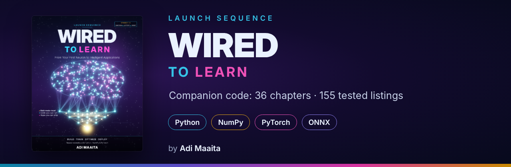

<p align="center">
  
</p>

<h1 align="center">Wired to Learn · Companion Code</h1>

<p align="center">
  <b>From Your First Neuron to Intelligent Applications</b><br>
  Build, train, optimize and deploy neural networks with Python, NumPy and PyTorch
</p>

<p align="center">
  <a href="https://github.com/launchsequencebooks/wired-to-learn/actions/workflows/smoke-tests.yml"></a>
  
  
  <a href="LICENSE"></a>
  <a href="https://launchsequencebooks.com/wired-to-learn"></a>
</p>

<p align="center">
  <a href="https://launchsequencebooks.com/wired-to-learn"><b>Get the book</b></a> ·
  <a href="#quick-start">Quick start</a> ·
  <a href="#chapters">Chapters</a> ·
  <a href="ERRATA.md">Errata</a> ·
  <a href="https://github.com/launchsequencebooks/wired-to-learn/discussions">Discussions</a>
</p>

---

This repository holds every program from the book **Wired to Learn** by **Adi Maaita**, the first
title in the *Launch Sequence* series (Ignition ▸ Liftoff ▸ Orbit).

- **155 listings in 36 chapters** (plus 7 in the appendices). Every listing printed in the book is here, and every one was run to produce the output printed beneath it.
- **The expected output is included.** Most longer programs have a `.log` file next to them, so you can compare your run with the book's.
- **Runs on an ordinary laptop.** Every result in the book was produced on a laptop CPU limited to two threads, with no GPU. A GPU is optional.
- **Three small kits you build yourself:** `tinynet` (your own deep-learning library, Part II), `wtlkit` (data loaders and training helpers) and `wtlapps` (application components, Part VII).

> The code in this repository is free to use under the MIT license. The book's text and figures
> are copyrighted and are **not** included here. You learn the ideas from the book and run them here.

## Quick start

```bash
git clone https://github.com/launchsequencebooks/wired-to-learn.git
cd wired-to-learn
python -m venv wtl-env
source wtl-env/bin/activate            # Windows: wtl-env\Scripts\activate
pip install -r requirements-parts-1-2.txt
cd code/ch01
python first_network.py                # your first neural network learns XOR
```

No Git? Click the green **Code** button above, choose **Download ZIP**, and unzip it.

When you reach **Chapter 10**, install the full stack:

```bash
pip install -r requirements.txt
```

On Windows or Linux without an NVIDIA GPU, you can save several gigabytes by installing the CPU build of PyTorch first:

```bash
pip install torch --index-url https://download.pytorch.org/whl/cpu
pip install -r requirements.txt
```

Appendix B of the book covers GPUs, macOS, Windows and cloud notebooks in detail.

### No Python on your computer? Use Google Colab

Open [`notebooks/run_in_colab.ipynb`](notebooks/run_in_colab.ipynb) in Colab
(<a href="https://colab.research.google.com/github/launchsequencebooks/wired-to-learn/blob/main/notebooks/run_in_colab.ipynb"></a>).
It clones this repository, installs the packages and runs any listing you pick, with a free GPU if you switch one on.

### Compare your output with the book

Every longer program has its expected output beside it as a `.log` file (for example
`code/ch16/fashion_resnet.log`). Your numbers may differ slightly in the last digits, because
floating-point results depend on the processor; timings always differ. A difference of many
points means something is wrong: compare your code with the listing.

## How the code is organized

```
wired-to-learn/
├── code/                  the book's code/ folder, exactly as the listings refer to it
│   ├── ch01 … ch36/       one folder per chapter; each has a README listing its programs
│   ├── tinynet/           the deep-learning library you write in Part II
│   ├── wtlkit/            dataset loaders and training helpers (Parts III–VII)
│   └── wtlapps/           application components (Part VII)
├── scripts/               regenerate the plotted figures of the book
└── requirements*.txt      minimum package versions
```

The captions in the book end with the file's path, for example `code/ch03/perceptron.py`.
Run each program **from its chapter folder**. Datasets download automatically on first use into
`code/data/`, which Git ignores.

## Chapters

**Part I · The Spark: Foundations**

| Ch | Title | Code | Listings |
|---:|---|---|---:|
| 1 | Meet the Neural Network | [`code/ch01`](code/ch01) | 1 |
| 2 | The Math Toolkit, Made Visual | [`code/ch02`](code/ch02) | 4 |
| 3 | The Artificial Neuron and the Perceptron | [`code/ch03`](code/ch03) | 2 |
| 4 | Activation Functions: Giving Networks Their Bend | [`code/ch04`](code/ch04) | 2 |
| 5 | Learning from Mistakes: Loss Functions and Gradient Descent | [`code/ch05`](code/ch05) | 2 |

**Part II · Building a Brain from Scratch**

| Ch | Title | Code | Listings |
|---:|---|---|---:|
| 6 | Multilayer Networks: The Forward Pass | [`code/ch06`](code/ch06) | 2 |
| 7 | Backpropagation, Step by Step | [`code/ch07`](code/ch07) | 4 |
| 8 | TinyNet: Your Own Deep-Learning Library | [`code/ch08`](code/ch08) | 10 |
| 9 | Project: Reading Handwritten Digits | [`code/ch09`](code/ch09) | 6 |

**Part III · Training Like a Pro**

| Ch | Title | Code | Listings |
|---:|---|---|---:|
| 10 | From TinyNet to PyTorch | [`code/ch10`](code/ch10) | 7 |
| 11 | Optimizers: From Momentum to Adam | [`code/ch11`](code/ch11) | 4 |
| 12 | Initialization and Normalization | [`code/ch12`](code/ch12) | 4 |
| 13 | Fighting Overfitting | [`code/ch13`](code/ch13) | 4 |
| 14 | The Training Playbook | [`code/ch14`](code/ch14) | 6 |

**Part IV · The Network Zoo**

| Ch | Title | Code | Listings |
|---:|---|---|---:|
| 15 | Convolutional Neural Networks | [`code/ch15`](code/ch15) | 4 |
| 16 | Modern CNNs and Transfer Learning | [`code/ch16`](code/ch16) | 5 |
| 17 | Recurrent Networks: RNN, LSTM and GRU | [`code/ch17`](code/ch17) | 5 |
| 18 | Attention and Transformers | [`code/ch18`](code/ch18) | 2 |
| 19 | Autoencoders and Variational Autoencoders | [`code/ch19`](code/ch19) | 4 |
| 20 | Generative Models: GANs and Diffusion | [`code/ch20`](code/ch20) | 2 |
| 21 | Graph Neural Networks | [`code/ch21`](code/ch21) | 4 |
| 22 | Choosing the Right Network | [`code/ch22`](code/ch22) | 1 |

**Part V · Learning Beyond Labels**

| Ch | Title | Code | Listings |
|---:|---|---|---:|
| 23 | Self-Supervised and Contrastive Learning | [`code/ch23`](code/ch23) | 3 |
| 24 | Reinforcement Learning with Neural Networks | [`code/ch24`](code/ch24) | 3 |
| 25 | Fine-Tuning and Parameter-Efficient Tuning | [`code/ch25`](code/ch25) | 3 |

**Part VI · Maximum Performance**

| Ch | Title | Code | Listings |
|---:|---|---|---:|
| 26 | Profiling and Faster Training | [`code/ch26`](code/ch26) | 5 |
| 27 | Quantization, Pruning and Distillation | [`code/ch27`](code/ch27) | 5 |
| 28 | ONNX, Inference Engines and Serving | [`code/ch28`](code/ch28) | 6 |

**Part VII · Building Intelligent Applications**

| Ch | Title | Code | Listings |
|---:|---|---|---:|
| 29 | Neural Networks as Application Components | [`code/ch29`](code/ch29) | 4 |
| 30 | Project: A Smart Photo Organizer | [`code/ch30`](code/ch30) | 5 |
| 31 | Project: A Ticket Triage Assistant | [`code/ch31`](code/ch31) | 8 |
| 32 | Project: A Log Anomaly Detector | [`code/ch32`](code/ch32) | 4 |
| 33 | Project: A Demand-Forecasting Dashboard | [`code/ch33`](code/ch33) | 4 |
| 34 | Project: A Recommender System | [`code/ch34`](code/ch34) | 6 |
| 35 | Project: Question Answering over Documents | [`code/ch35`](code/ch35) | 8 |
| 36 | Testing, Monitoring and MLOps | [`code/ch36`](code/ch36) | 6 |

### Appendices
A · Python & NumPy crash course · B · Setup · C · Math reference · D · Answers to the exercises.
These appendices are in the book.

## Trained files: train them yourself or download them

Later chapters reuse networks trained earlier (for example, Chapter 28 serves the ResNet-20 trained in
Chapter 16). If you work through the book in order, those files are already on disk. If you jump in
later, download them once (about 40 MB) from the
[`v1.0-artifacts` release](https://github.com/launchsequencebooks/wired-to-learn/releases/tag/v1.0-artifacts):

```bash
cd code
python scripts/fetch_artifacts.py ch30      # only what Chapter 30 needs
python scripts/fetch_artifacts.py --list    # what would be fetched, and how long training it takes
```

## Running the applications (Part VII)

| Chapter | Application | Start it with |
|---:|---|---|
| 30 | Smart photo organizer | `streamlit run app.py` |
| 31 | Ticket triage assistant | `uvicorn triage_service:app` |
| 33 | Demand-forecasting dashboard | `streamlit run dashboard.py` |
| 34 | Recommender service | `uvicorn rec_service:app` |
| 35 | Question answering over the book | `streamlit run qa_app.py` |
| 28 | Image classifier as a container | `docker build -t clothing-classifier .` |

## Datasets

The code downloads public datasets from their original or mirrored sources the first time you need them.
They are **not** redistributed in this repository, and each one stays under its own license:
MNIST, Fashion-MNIST, Tiny Shakespeare, Daily Minimum Temperatures (Melbourne), Cora, *Alice’s
Adventures in Wonderland* (Project Gutenberg), Banking77, HDFS logs (Loghub), MovieLens 100K
(GroupLens) and UCI Bike Sharing. See [`code/wtlkit/datasets.py`](code/wtlkit/datasets.py) for the exact sources.

## Found a mistake? Need help?

- **Errata (a mistake in the book or the code):** [open an errata report](https://github.com/launchsequencebooks/wired-to-learn/issues/new/choose). Confirmed errata are listed in [ERRATA.md](ERRATA.md), and readers who report them are credited.
- **Questions about the code:** ask in [Discussions](https://github.com/launchsequencebooks/wired-to-learn/discussions). Please include the chapter and listing number, your operating system and the full error message.

## About the book

**Wired to Learn: From Your First Neuron to Intelligent Applications** takes you from a single
artificial neuron to six complete intelligent applications. You build a deep-learning library from scratch
in NumPy, move to PyTorch, explore CNNs, LSTMs, Transformers, VAEs, GANs, diffusion, graph networks and
reinforcement learning, make models small and fast, and ship them with ONNX, FastAPI and Streamlit.

**[Get the book at launchsequencebooks.com →](https://launchsequencebooks.com/wired-to-learn)**

## Citation

If this book or code helps your work, please cite it. GitHub shows a **Cite this repository** button
in the sidebar, or you can use:

```bibtex
@book{maaita2026wiredtolearn,
  author    = {Adi Maaita},
  title     = {Wired to Learn: From Your First Neuron to Intelligent Applications},
  series    = {Launch Sequence},
  year      = {2026},
  url       = {https://launchsequencebooks.com/wired-to-learn}
}
```

## License

The source code is released under the [MIT License](LICENSE).
The book's text, figures and cover are © 2026 Adi Maaita. All rights reserved.
